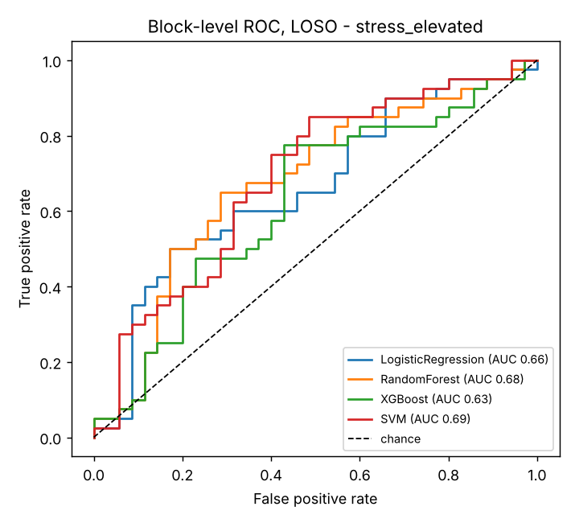
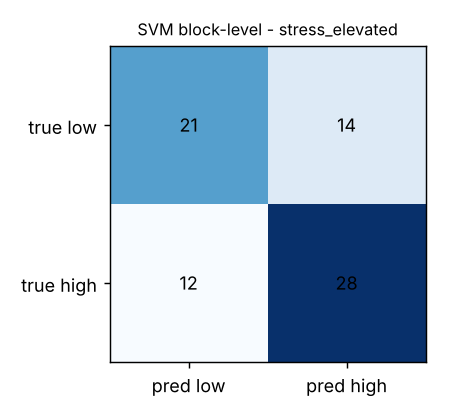
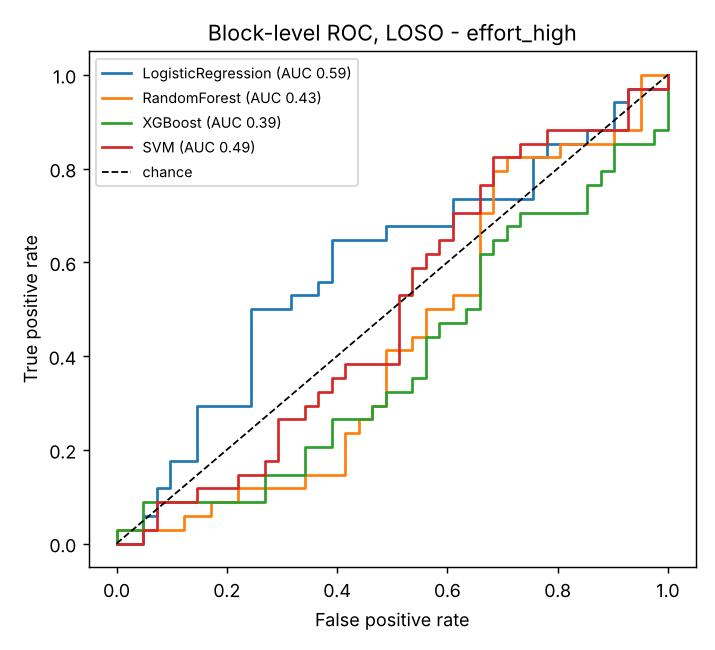
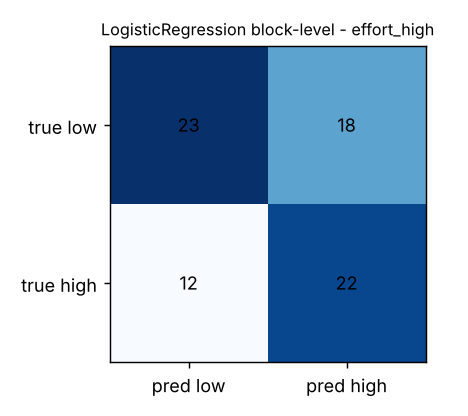

# Model Evaluation Report

_Generated by `python -m ml.train` on 2026-11-20 11:29 UTC. Every number below was produced by that run._

## Setup
- Data: SWELL-KW per-minute computer-interaction features (`swell_computer_sheet1.csv`), cleaned as described in `phase1_dataset_findings.md`.
- Windows: 5 consecutive minutes, stride 1 minute. 2355 windows from 25 participants and 75 labelled blocks.
- Features: 19 window features, each expressed as a z-score against the participant's own history (baseline-relative).
- Validation: Leave-One-Subject-Out (25 folds). No participant appears in both training and test.
- Window-level metrics treat each window as a sample, but windows overlap and share one block label, so they are **not independent**. **Block-level** rows (mean window score per labelled block, 75 blocks) are the honest unit and are the ones used for model selection.
- Hyper-parameters are fixed (not tuned) to avoid leakage with only 25 participants.
- Model selection uses the same LOSO scores that are reported, so the winner's score carries a small optimistic selection bias.

## Primary target: stress above the person's own mean (`stress_elevated`)
Positive share: 0.53

| Model | Level | Accuracy | Bal. acc. | Precision | Recall | F1 | ROC-AUC |
|---|---|---|---|---|---|---|---|
| LogisticRegression | window | 0.555 | 0.556 | 0.584 | 0.538 | 0.560 | 0.571 |
| LogisticRegression | **block** | 0.587 | 0.586 | 0.615 | 0.600 | 0.608 | 0.661 |
| RandomForest | window | 0.561 | 0.558 | 0.579 | 0.600 | 0.590 | 0.581 |
| RandomForest | **block** | 0.667 | 0.666 | 0.692 | 0.675 | 0.684 | 0.676 |
| XGBoost | window | 0.544 | 0.542 | 0.564 | 0.594 | 0.578 | 0.547 |
| XGBoost | **block** | 0.667 | 0.659 | 0.660 | 0.775 | 0.713 | 0.626 |
| SVM | window | 0.557 | 0.555 | 0.576 | 0.593 | 0.585 | 0.574 |
| SVM | **block** | 0.653 | 0.650 | 0.667 | 0.700 | 0.683 | 0.687 |
| Majority class | block | 0.533 | 0.500 | 0.533 | 1.000 | 0.696 | 0.500 |
| Condition only (N/I/T known) | block | 0.600 | 0.589 | 0.600 | 0.750 | 0.667 | 0.321 |

**Selected model:** SVM - ROC-AUC 0.687 (95% CI 0.56 - 0.80), F1 0.683 (95% CI 0.57 - 0.77), within-person permutation p = 0.0020

**Verdict:** Weak but statistically detectable signal in held-out participants.

 

## Secondary target: mental effort above the person's own mean (`effort_high`)
Positive share: 0.45

| Model | Level | Accuracy | Bal. acc. | Precision | Recall | F1 | ROC-AUC |
|---|---|---|---|---|---|---|---|
| LogisticRegression | window | 0.544 | 0.542 | 0.499 | 0.514 | 0.506 | 0.555 |
| LogisticRegression | **block** | 0.600 | 0.604 | 0.550 | 0.647 | 0.595 | 0.590 |
| RandomForest | window | 0.477 | 0.473 | 0.425 | 0.428 | 0.427 | 0.466 |
| RandomForest | **block** | 0.440 | 0.433 | 0.375 | 0.353 | 0.364 | 0.428 |
| XGBoost | window | 0.464 | 0.451 | 0.388 | 0.312 | 0.346 | 0.439 |
| XGBoost | **block** | 0.427 | 0.403 | 0.263 | 0.147 | 0.189 | 0.394 |
| SVM | window | 0.497 | 0.490 | 0.442 | 0.410 | 0.426 | 0.495 |
| SVM | **block** | 0.480 | 0.464 | 0.400 | 0.294 | 0.339 | 0.494 |
| Majority class | block | 0.547 | 0.500 | 0.000 | 0.000 | 0.000 | 0.500 |
| Condition only (N/I/T known) | block | 0.480 | 0.479 | 0.432 | 0.471 | 0.451 | 0.554 |

**Selected model:** LogisticRegression - ROC-AUC 0.590 (95% CI 0.43 - 0.74), F1 0.595 (95% CI 0.43 - 0.74), within-person permutation p = 0.1064

**Verdict:** No reliable signal: the participant-bootstrap interval for the block-level ROC-AUC includes 0.5 or the permutation check is not significant.

 

## Limitations (read before using the predictions)
- Only 75 labelled blocks from 25 participants; confidence intervals are wide.
- Labels are self-reported once per block, not per minute.
- Training data came from system-wide logging on office PCs; the website only sees events on its own page, so live behaviour differs from the training distribution.
- The model score is **not a calibrated probability** and **not a diagnosis**.
